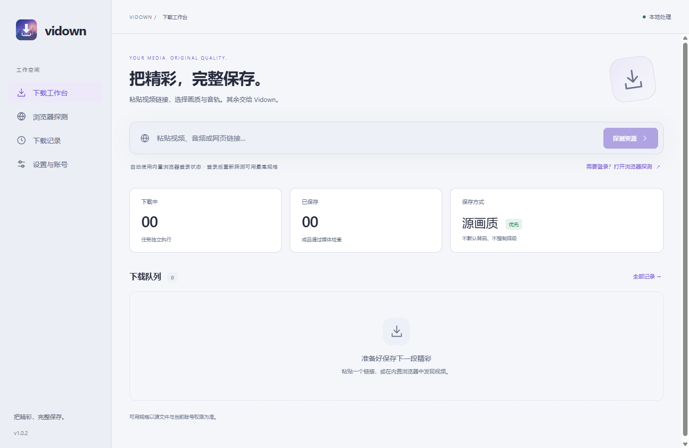
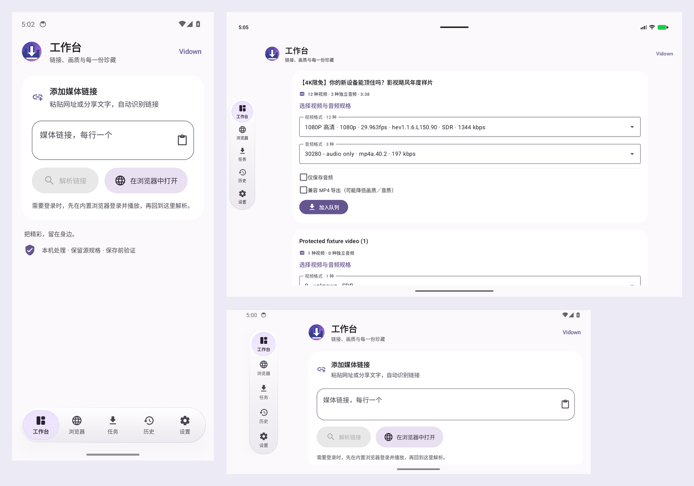

# Vidown

> 把精彩，完整保存。

一个从零重写的本地视频下载器：粘贴链接解析，或在内置浏览器中登录、播放并发现媒体，选择音视频轨道后保存到本机。优先保留源编码，下载完成后检查成品。

**桌面版 1.0.5 · Android 0.1.0-preview.4。** 两端独立开发和发行。桌面 Windows 网页使用系统 WebView2，本地界面由 Electron 承载；Android 使用原生 Kotlin／Jetpack Compose／Material 3 与 GeckoView。旧 Python 工程仅保留在 Git 历史中，没有复用旧业务代码。公开安装包和已验证范围以对应 Release 为准。

[项目介绍](https://jimmy-xuzimo.github.io/vidown/) · [桌面指南](docs/USER_GUIDE.md) · [Android 指南](docs/ANDROID.md) · [更新历史](docs/CHANGELOG.md) · [测试记录](docs/VALIDATION.md) · [后续计划](docs/ROADMAP.md)

**Android 预览版：** 原生 Kotlin／Jetpack Compose 工程现位于 [`android/`](android/README.md)，支持 Android 14+ 的手机和平板，使用独立版本号。下载 [Android 0.1.0-preview.4 APK](https://github.com/Jimmy-xuzimo/vidown/releases/tag/android-v0.1.0-preview.4)。浏览器与运行时随包提供；横竖屏导航、音视频格式选择、受控协议下载与公开样本分别验收，真实会员账号及真机后台性能仍需验证，详见 [Android 验收记录](android/ACCEPTANCE.md)。桌面版能力矩阵不作为 Android 的支持声明。



## 桌面版能做什么

- **两种发现入口**：直接粘贴链接，或用内置浏览器登录并播放，再解析当前页面或侧栏资源；识别不依赖 URL 扩展名。
- **独立选择音视频**：展示源返回的分辨率、帧率、编码、动态范围与音轨；未知或缺少的参数如实显示。支持单独保存音频。
- **通用点播协议**：HLS 主清单、分离音轨、TS／fMP4、初始化片段、字节范围与普通 AES-128 密钥轮换；DASH 常见模板与时间线；HTTP／HTTPS 直链。
- **源规格保存**：默认不重新编码，适合的组合保存为 MP4，部分高规格组合使用 MKV。下载、合并与验证分别呈现，验证通过后才标记完成。
- **统一内置登录**：登录状态保存在本机，解析与下载使用相同会话。Cookie 遵循网站有效期；临时会话 Cookie 在系统安全存储可用时加密备份最多 7 天。网站可使登录提前失效。
- **队列与记录**：并发 1–4、同次会话暂停与恢复、取消、历史搜索。支持单条删除和一键清理，默认保留文件，可选择把成品移至回收站。
- **紧凑工作台**：固定高度标签、自动补全网址协议、网页缩放、可折叠资源栏、柔和的新标签页；四套配色与深浅模式，动效可关闭，无鼠标微光。
- **剪贴板填入**：监听可关闭；复制链接只填入输入框，不会自行访问、解析或下载。

**没有外部浏览器 Cookie 导入、cookies.txt 导入或配套导出扩展。** 需要账号的网站统一在内置浏览器登录。此版本已完整移除此前尝试的导入入口和后台接口。

## 实测范围与限制

通用协议和桌面功能使用可重复的本地真实媒体服务验证，详见[本轮回归](docs/VALIDATION.md)。历史版本还验证过以下真实样本；这些结果仅对应所列样本及当时版本，不能自动扩展为所有内容或新浏览器后端的完整账号验收。

| 范围                 | 已有证据                                                                                                                                                                | 仍需验证                                               |
| -------------------- | ----------------------------------------------------------------------------------------------------------------------------------------------------------------------- | ------------------------------------------------------ |
| 通用 HLS／DASH／直链 | 分轨、加密样本、暂停与源变化校验、合并及成品检查                                                                                                                        | 更多清单变体、不同站点的风控与授权限制                 |
| 抖音网页             | 1.0.5 在 Windows 的 WebView2／Chromium 中验证精选页 `modal_id` 和视频长链；用户长视频 4K HEVC＋AAC 片段、另一短视频完整成品通过检查，详见[本轮记录](docs/VALIDATION.md) | 分享短链、真实登录／私密内容及 macOS／Linux 实机       |
| B 站                 | 4K Dolby Vision Profile 8＋Atmos、8K SDR、独立 4K HDR10、48 kHz／24-bit FLAC，以及备用 CDN，历史完整码流哈希检查通过                                                    | 新浏览器后端真实会员账号、其他规格组合、番剧和试看边界 |
| X                    | 公开短视频完整下载及码流哈希检查，长视频短分片验证                                                                                                                      | 登录内容和单帖多视频                                   |
| Telegram 网页        | Web A／K 受控 DOM、原生 blob／文件保存与权限处理                                                                                                                        | 真实账号、私有消息与页面变化                           |
| YouTube 及其他站点   | 使用固定版本 yt-dlp 提取器和浏览器发现链路                                                                                                                              | 当前版本的真实账号和逐站点最高规格验收                 |

页面能播放不保证可以下载。账号权限、源提供的规格、地域、试看、DRM 和网站风控会影响结果。没有直播录制、合集或频道批量抓取，不提供 DRM 或账号权限绕过。

应用重启后保留任务记录，但**需要重新探测并新建任务**，不能自动续用旧授权。失效签名自动刷新、跨重启安全续传、引擎独立更新回滚及外部浏览器资源发现扩展仍未完成。干净系统安装／卸载、更多 Linux 发行版和真实会员／私有账号验收尚未完成。

## Android 原生预览版

支持 Android 14+ 的手机、平板与横竖屏窗口，同一签名 APK 包含 ARM64 和 x86_64。浏览器、Python、提取器及媒体库随包提供，无需配置运行时。它是独立原生应用，不是桌面版套壳；完整迁移和真实设备验收仍在进行中。



- 工作台顶部粘贴／分享链接，解析后分别选择视频与音频。B 站链接保留分 P、源格式和备用 CDN，拒绝将 HTML 页面当成媒体。
- Gecko 浏览器默认桌面模式，多标签、登录保存、资源发现与工作台共享会话；不导入外部浏览器 Cookie。
- Media3 下载 HLS／DASH／直链，JNI／FFmpeg 无损合并和检查，成功后写入 MediaStore 或系统授权的文件夹。
- UIDT 后台下载、WorkManager 后处理、队列、历史与数据清理；同次运行可安全暂停恢复，重启须重新解析。
- Material 3 原生界面，竖屏底部、横屏左侧的居中悬浮导航；四套深浅配色和可关闭的 Compose 动效。

受控协议及公开 B 站样本已有模拟器下载证据；**真实会员最高规格、ARM64 真机、厂商后台策略、续航／温控仍待验证**。它尚非稳定版，未上架 Google Play，不能把桌面能力矩阵当作 Android 验收结果。详见 [Android 安装与使用](docs/ANDROID.md)、[验收记录](android/ACCEPTANCE.md)及[隐私政策](android/PRIVACY.md)。

## 获取与运行

在 [GitHub Releases](https://github.com/Jimmy-xuzimo/vidown/releases/latest) 选择系统和处理器架构。正式附件由 Actions 在五个原生运行器构建、验证后统一发布：

| 平台                           | 安装／免安装格式                                |
| ------------------------------ | ----------------------------------------------- |
| Windows x64                    | Setup 安装 EXE                                  |
| macOS 15+ Intel／Apple Silicon | 各自的 DMG                                      |
| Linux x64／ARM64               | 各自的 AppImage（Ubuntu 24.04 构建）            |
| Android 14+ ARM64／x86_64      | 独立 Android Release 中的单一通用 APK（预览版） |

桌面 Release 仅列 5 个应用包（Windows 安装版、两种架构的 macOS DMG 和 Linux AppImage）；SHA-256、测试报告和第三方对应源码／构建材料保存在[桌面资料页](https://github.com/Jimmy-xuzimo/vidown/releases/tag/v1.0.5-materials)。Android 使用[独立预览 Release](https://github.com/Jimmy-xuzimo/vidown/releases/tag/android-v0.1.0-preview.4)和[对应源码／校验材料](https://github.com/Jimmy-xuzimo/vidown/releases/tag/android-materials-v0.1.0-preview.4)，不使用 `/releases/latest` 获取 Android。请按附件选择，不把源码 ZIP 当作安装包。Windows 未签名；macOS 只有 ad-hoc 签名，没有 Developer ID／公证；系统可能提示来源验证。

最终用户无需安装 Python、Node.js 或 .NET。应用包自带下载工具与原生宿主运行时；Windows 网页需要系统的 [Microsoft Evergreen WebView2 Runtime](https://developer.microsoft.com/microsoft-edge/webview2/)。产品名称为 Vidown，沿用 `%APPDATA%/Vidown Preview` 资料目录以保留已有记录；旧 Chromium 完整站点存储不会自动迁移到 WebView2，升级后可能需要登录一次。

### 从源码开发和打包

下列为桌面命令。Android 使用独立 Gradle 工程与固定 JDK／SDK／NDK，完整步骤见 [Android 工程说明](android/README.md)及[多平台构建](docs/BUILDING.md)，不通过 npm 构建 APK。

需要 Node.js 24.13+、Git；Windows 另需 .NET SDK 8。下列快速开发命令适用于 Windows，其他系统按多平台构建说明准备源码工具。固定依赖版本和校验值由准备脚本记录；公开发行使用固定源码构建 FFmpeg／x264 与独立提取器，并保留精确依赖及对应源码；详见[多平台构建](docs/BUILDING.md)。

```powershell
npm ci
npm run setup
npm run native:build
npm run dev
```

```powershell
npm run check              # 类型检查、生产构建、单元／本地集成测试
npm run format:check
npm run verify:media       # 真实媒体协议、保真、暂停与源变化
npm run verify:protocol-edges
npm run verify:mirrors
npm run dist               # 同时生成安装版和便携版
```

打包后的桌面验收使用 `VIDOWN_VERIFY_EXECUTABLE` 指向 `release/win-unpacked/Vidown.exe`，执行 `verify:webview2`、`verify:interface`、`verify:desktop`、`verify:tasks`、`verify:shutdown`、`verify:browser-session`、`verify:web-downloads` 和 `verify:startup`。这些脚本使用隔离档案；部分检查会临时替换系统剪贴板或把受控文件放入回收站，请在专用测试环境运行。

## 结构与许可证

`src/core` 管理桌面协议、下载进程、传输桥与成品检查；`src/main` 管理桌面浏览器、会话和任务；`src/preload` 提供受限 IPC；`src/renderer` 为桌面工作台；`native/WebViewHost` 为 Windows WebView2 宿主；`android` 是独立原生 Android 工程及其测试／第三方构建配方；`scripts`／`tests` 提供桌面准备和验收；`site` 为含双端更新历史的 GitHub Pages 介绍页。

详见[架构](docs/ARCHITECTURE.md)与[研究参考](docs/REFERENCES.md)。自有代码采用 [MIT](LICENSE)，第三方二进制、运行时及库遵循各自许可，不能把整个安装包笼统标为 MIT，见[第三方组件说明](THIRD_PARTY_NOTICES.md)。

## 参与项目

提交问题或建议请使用 [Issue 表单](https://github.com/Jimmy-xuzimo/vidown/issues/new/choose)，代码贡献参见[贡献指南](CONTRIBUTING.md)。参与交流请遵守[行为准则](CODE_OF_CONDUCT.md)；安全漏洞请按照[安全政策](SECURITY.md)私密报告，不在公开 Issue 中提交凭据或未修复的利用细节。
