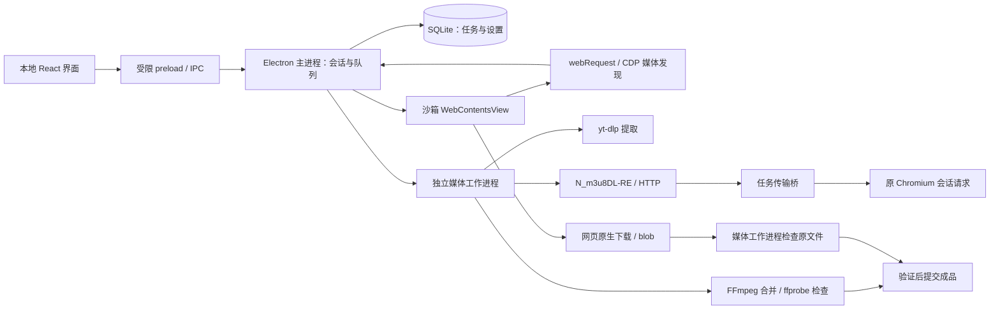

# 重建架构（M0 实现）

旧 Python 工程只保留在 Git 历史中。新源码不导入旧调度器、HLS 下载器或页面扫描器。

`SourceCandidate` 是媒体发现记录；`RequestContextRef` 引用本机会话；`MediaAsset` 展示轨道；`DownloadPlan` 固定具体选择及引擎所需执行信息；`TaskEvent` 描述状态变化。平台格式 ID 不作为另一引擎的选择参数，DASH 有独立 selector。渲染进程拿不到原始媒体 URL、请求头或 Cookie。

任务从 queued 进入 downloading、merging、verifying（原文件保存可直接从 downloading 进入 verifying），验证通过后才成为 completed；也可进入 paused、cancelled、failed。状态迁移有明确约束，已完成或取消的任务不能重新排队。任务记录每次持久化递增 sequence；阶段事件与任务记录在同一 SQLite 事务提交，速度更新只增加记录版本，不生成重复阶段事件。Snapshot 使用递增 revision，界面拒绝晚到的旧快照。SQLite user_version=1 从早期无版本数据库原子升级，保留设置与加密计划；拒绝打开未知的更高版本数据库。

SQLite 启动时把意外遗留的活动任务标为 interrupted。当前敏感计划加密保存，但重启不会重用旧授权，界面取消虚假的继续入口，明确要求重新探测。跨进程事件重放、自动重新匹配及稳定服务迁移仍属于 M1／M3。

远程页面无应用 preload、Node 权限或应用 IPC；启用沙箱、上下文隔离，拒绝设备等权限。只有本地窗口的主 frame 可调用应用接口。浏览器与下载使用相同代理策略。临时 Cookie 文件仅用于隔离提取器，正常结束删除，启动时也清除中断遗留文件；诊断不包含凭据正文。

浏览器界面采用窗口内的 flex 布局，原生 WebContentsView 的位置按本地界面的实际 zoom factor 换算到 DIP，并限制在可见内容区域。网页默认按可用宽度缩放，可按网站保存手动比例；资源栏可收起。

持久分区 `persist:vidown-browser` 同时服务网页浏览、工作台提取及媒体传输。Chromium 原生保存持久 Cookie 和站点存储；临时会话 Cookie 使用 safeStorage 加密保存在本机设置中，恢复窗口最多 7 天，不改变网站持久 Cookie 的过期时间，不覆盖已有的新 Cookie。Cookie 改变后更新备份，正常退出前刷盘；清除登录会删除原生存储及备份。系统安全存储不可用时不写明文会话备份。

传输桥绑定 127.0.0.1，每任务有随机 capability，只允许已登记资源和已解析的分片模板。跨域跳转按目标地址重新选择请求头。Chromium 负责域匹配 Cookie；显式 referrer policy 保留已观察的页面来源。仅清单引用的片段／初始化文件／密钥使用完整响应缓存，直链不从片段缓存读取。HLS 恢复检查原清单 SHA-256；HTTP 恢复验证强 ETag、If-Range、Content-Range。身份不确定就重新下载或拒绝继续。

B 站补充适配器只读取同一会话网页中的 JSON，按完整媒体路径及编码为已有轨道登记备用 HTTPS 地址。地址不进入 renderer。每个备用源使用独立文件和检查点，绝不因为不同源 ETag 恰好相同就跨源续接。传输桥按实际响应流统计本次网络字节与速度；它们包含重试的传输量，与已验证完整轨道字节分别记录。30 秒无上游数据会终止请求，不把不完整响应提交到缓存。

DASH 多 Period 在解码参数一致、轨道 ID 连续存在、时间范围无空档时拆为独立清单，逐个交给 N_m3u8DL-RE；再核对实际编码配置和完整时长，由 FFmpeg stream copy 拼接。编码配置、轨道或时间范围变化时停止，不重写协议下载器或默默丢掉 Period。

媒体执行器调用真实组件。FFmpeg 默认 `-c copy`；先检查源轨及输出轨的编码、尺寸、帧率、音频参数、时长、色彩和相关元数据，然后在目标文件系统内提交成品。兼容导出是独立选项，M0 明确拒绝没有显式色彩转换的 HDR／杜比降级。完整码流哈希验证另由真实样本验收脚本执行，常规完成检查不声称逐帧完整验证。

正常关闭时先停止队列、通知工作进程中止组件、关闭任务桥并等待退出，再结束 utility process。中断任务保留 interrupted 状态；Windows 已验证下载子进程消失及源请求停止。这不等于操作系统强杀情况下也能完成相同的清理。

M0 的 SQLite 和队列协调仍在 Electron 主进程，协议和媒体处理在 utility process。Telegram 不使用 TDLib 或自有 API 身份。当前 Windows x64 包自带 Chromium 与所有工具；其余平台、干净系统、完整异常恢复及发行合规以路线图验收门槛为准。

Telegram 按消息链接进入同一持久分区内的官方 Web A。应用仅定位消息 DOM 和网页实际提供的下载菜单，不读取客户端内部会话密钥，不注入应用 IPC。解析和开始保存时检查同一标签、消息及页面指纹，找不到目标或下载操作则停止；不绕过禁止保存。该 DOM 适配随上游网页变化可能失效，真实账号尚未验收，Web K 未适配。入口仍为统一浏览器和链接表单。

网页下载（含 blob）由 Chromium DownloadItem 接收；只有应用拥有的远程 WebContents 能进入保存流程。视频／音频先落在任务临时目录，经 ffprobe 参数和首尾解码检查，再按原文件复制到所选目录，不转码。网页内部准备文件阶段没有可靠字节进度；任务显示等待，取消后拒绝迟到的文件保存，网页内部缓存／预取仍由网页管理。实际 DownloadItem 传输可取消，仅 Chromium 确认可继续时提供暂停／恢复。网页发起的文件不受协议引擎的并发配置控制。重启后要求重新解析。
